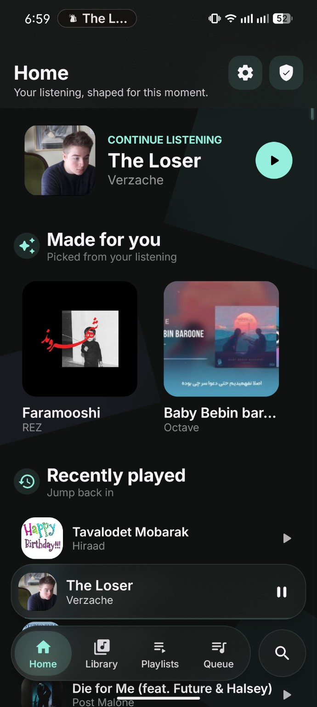
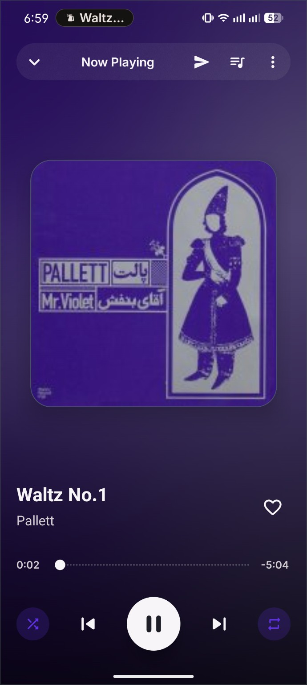
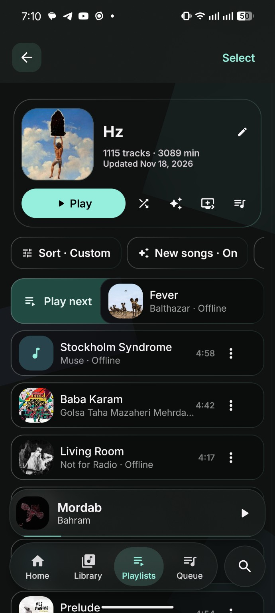
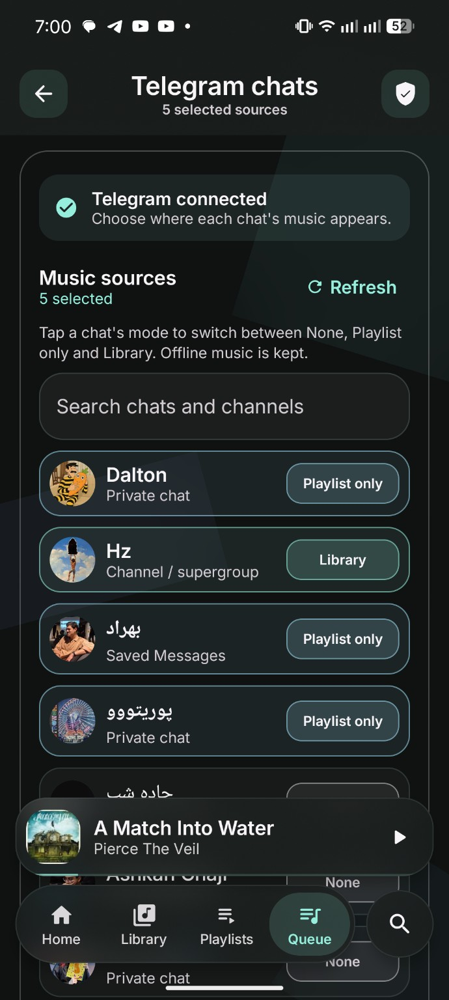
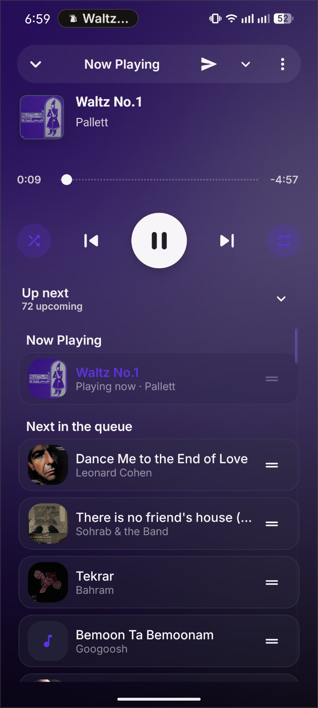
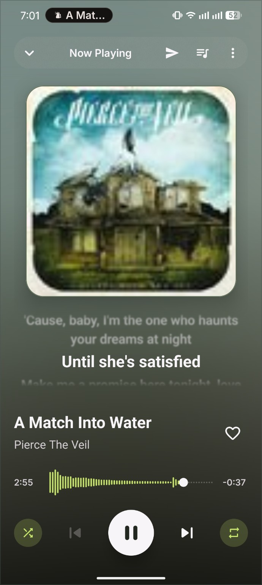
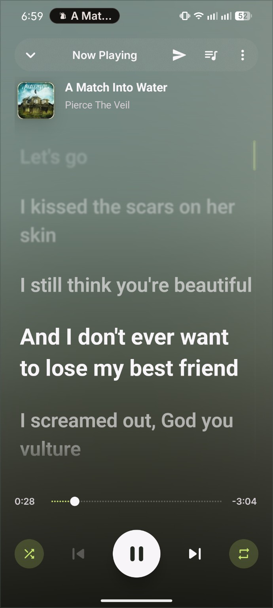
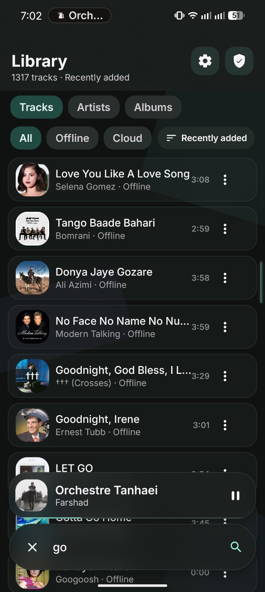

  

<h1 align="center">Meowzix</h1>

<strong>Your music, wherever it lives.</strong>

  A local-first Android music player combining your phone's audio with music from Telegram. 
  Beautiful playback, offline access, and personalized discovery — all in one app.

  
  
  

  <a href="https://github.com/BehradHZ/meowzix/releases/latest"><strong>Download APK</strong></a> ·
  <a href="#features">Features</a> ·
  <a href="#installation">Installation</a> ·
  <a href="#build-from-source">Build from source</a>

<table align="center">
  <tr>
    <td align="center" valign="top"> <b>Home</b></td>
    <td align="center" valign="top"> <b>Now Playing</b></td>
    <td align="center" valign="top"> <b>Telegram Playlist</b></td>
  </tr>
</table>

Actual Meowzix Android screenshots

---

## Features

### Music from your phone and Telegram

Meowzix unifies music indexed from your Android device with audio from **Telegram Saved Messages, selected chats, groups, and channels**. Each chosen Telegram chat can act as a playlist — you don't have to copy every song into your phone's music folder or keep the Telegram app open.

- **Persistent library:** Imported tracks remain organized across app restarts, with cloud/offline availability shown per track.
- **Offline downloads:** Save Telegram music for later listening, track download progress, and retry failed transfers.
- **Telegram sharing:** Send or forward tracks using an in-app chat picker, including chat folders and search.
- **Source-independent playback:** Local audio continues working when Telegram or the network isn't available.

 <b>Telegram source management</b>

### Playback and queue

Built on **Media3 / ExoPlayer**, Meowzix supports uninterrupted background listening with lock-screen controls, media notifications, Bluetooth/headset buttons, and audio-focus handling.

- **Editable queue:** Play Next, add, remove, and reorder tracks; resume the previous session.
- **Playback modes:** Ordered play, repeat options, and separate Pure/Smart Shuffle modes.
- **Sleep Timer:** Stop at a selected time or at the end of the track, with optional fade.
- **Seamless transitions:** Gapless and configurable crossfade, plus loudness handling where supported.

 <b>Editable playback queue</b>

### Smart Shuffle and personalized listening

**Pure Shuffle** randomly orders eligible tracks without repeats inside a cycle. It never uses your preferences. **Smart Shuffle** is different: it learns locally from skips, completions, favorites, listening time, and recent history to help choose what plays next.

Personalized mixes and exploration help surface less-played music instead of only replaying the same favorites. The source-agnostic recommendation pipeline can learn from local and Telegram tracks; it does **not** need a cloud AI service.

### Lyrics and a more expressive player

- **Synchronized lyrics:** A compact three-line view highlights the current lyric while fading adjacent lines; expand it to scroll through the full song.
- **Follow along:** Lyrics automatically follow playback and support manual scrolling.
- **Artwork-led design:** Glass-inspired surfaces, animated transitions, album-art accents, and customizable light/dark colors.
- **Personal themes:** Preset or custom accents, with Material You integration on supported Android versions.

<table align="center">
  <tr>
    <td align="center" valign="top"> <b>Synced lyrics + waveform</b></td>
    <td align="center" valign="top"> <b>Expanded lyrics</b></td>
  </tr>
</table>

### Sound and visual controls

- **Equalizer:** Adjust the audio session with presets and available device-supported effects.
- **Audio visualizer:** Live spectrum/waveform views and selectable seekbar styles.
- **Output controls:** Integration with Android audio routing and connected playback devices.

Effect availability varies with Android hardware and the audio route.

### Library, search, and organization

Browse songs, artists, albums, favorites, playlists, and recent listening history. Search works across the unified library, with normalization designed to handle Persian and English text.

There are also tools for **duplicate management**, locally stored library data, and **backup/restore**. Your playlists, queue, and preferences are managed within Meowzix.

 <b>Library filters + contextual search</b>

### Music beyond the app

Control playback from the **animated vinyl home-screen widget**, complete with a spinning record and moving tonearm. The Android media notification can show track metadata, progress, and configurable controls. An **Android Auto** media-library integration is also implemented for compatible hosts.

> **Compatibility:** Some audio effects and Android integrations depend on the device. Source-code checks do not replace physical-device and Android Auto host testing. See [verification status](docs/PRODUCT_IMPROVEMENTS_STATUS.md).

## Installation

Download the latest release-signed APK from **[GitHub Releases](https://github.com/BehradHZ/meowzix/releases/latest)**.

1. Install on **Android 8.0 (API 26) or newer**.
2. Allow access to device audio for local music.
3. Optionally connect Telegram and select the chats containing your music.

The release also includes a checksum file for APK verification.

## Build from source

Requires **JDK 17**, **Android SDK 37**, and the included Gradle wrapper.

~~~bash
git clone https://github.com/BehradHZ/meowzix.git
cd meowzix
./gradlew :app:assembleDebug
~~~

On Windows, use <code>gradlew.bat</code>. For Telegram-enabled builds, supply your own API credentials outside version control using the [setup guide](docs/setup/TELEGRAM_CREDENTIALS.md).

## Architecture and privacy

**Kotlin · Jetpack Compose · Material 3 · Media3 · Room · Hilt · Coroutines / Flow · TDLib**

The library models a song separately from its device, Telegram, or downloaded sources. Listening history, recommendation training, and personalization state are kept **on-device by default**; the player does not require a developer-operated backend.

[System specification](docs/MEOWZIX_SYSTEM_SPEC.md) · [Recommendation architecture](docs/architecture/ADR_012_LOCAL_RECOMMENDATIONS.md) · [Contributing](CONTRIBUTING.md) · [AGPL-3.0 License](LICENSE)

---

Made for music that lives everywhere.

